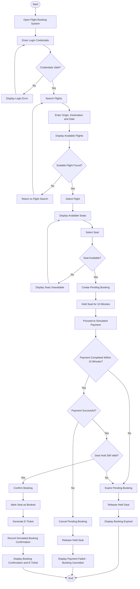

# Activity Diagram - Flight Booking System

## 1. Overview

This document describes the customer flight booking process, including login, flight search, seat selection, the 10-minute seat hold, simulated payment, booking confirmation, and e-ticket generation.

## 2. Activity Diagram

## 3. Main Activity Descriptions

| Activity | Description |
|---|---|
| Customer Login | The customer enters their email and password to access the system. |
| Search Flights | The customer searches by origin, destination, and travel date. |
| Select Flight | The customer selects a suitable flight or searches again. |
| Select Seat | The customer chooses a seat, and the system checks its availability. |
| Temporary Seat Hold | The system creates a pending booking and holds the selected seat for 10 minutes. |
| Simulated Payment | The customer submits payment while the seat hold is active. |
| Payment Failure | The system cancels the pending booking, releases the seat, and displays a payment failure message. |
| Hold Expiration | When the hold expires before confirmation, the system marks the pending booking as expired, releases the seat, and displays an expiration message. |
| Booking Confirmation | After successful payment, the system verifies that the hold is still valid, confirms the booking, and marks the seat as booked. |
| Ticket and Notification | The system generates an e-ticket, records a simulated booking confirmation, and displays the confirmation and ticket to the customer. |

## 4. Business Rules

1. Customers must log in before booking a flight.
2. Only an available seat can be reserved. The availability check, pending booking creation, and seat hold must occur in one database transaction to prevent double booking.
3. The seat hold lasts 10 minutes from the creation of the pending booking.
4. When the hold expires, the system marks the pending booking as `EXPIRED` and releases the seat.
5. If payment fails while the hold is active, the system marks the pending booking as `CANCELLED`, releases the seat, and displays a payment failure message.
6. The system confirms a booking only if payment succeeds and the booking still owns an active hold on the seat.
7. The system generates an e-ticket only after confirming the booking.
8. Payment processing and booking notifications are simulated.

## 5. Related Documents

- [Requirements](../docs/requirements.md)
- [Architecture](../docs/architecture.md)
- [Booking Sequence Diagram](sequence_booking.md)
- [Booking State Diagram](state_booking.md)
- [Class Diagram](class_diagram.md)
- [Entity Relationship Diagram](erd.md)