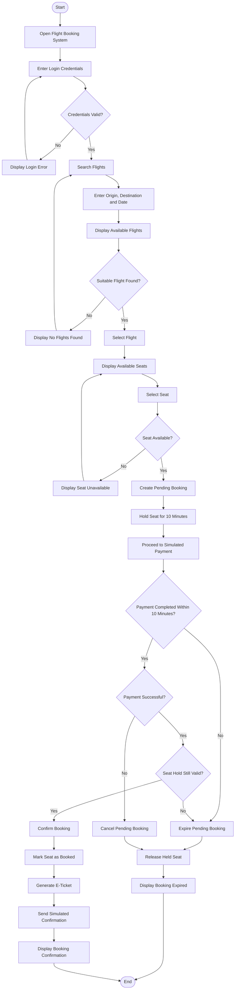

# Activity Diagram - Flight Booking System

## 1. Overview

This document describes the activity flow for the Flight Booking System, focusing on the customer flight booking process.

The diagram covers customer authentication, flight search, seat selection, temporary seat reservation, simulated payment, booking confirmation, and ticket generation.

## 2. Activity Diagram

## 3. Main Activity Descriptions

| Activity | Description |
|---|---|
| Customer Login | The customer enters their email and password to access the system. |
| Search Flights | The customer searches using origin, destination, and travel date. |
| Select Flight | The customer selects a suitable available flight. |
| Select Seat | The customer chooses an available seat. |
| Temporary Seat Hold | The system holds the selected seat for 10 minutes. |
| Simulated Payment | The customer completes a simulated payment transaction. |
| Booking Confirmation | The system confirms the booking only after successful payment and valid seat hold. |
| Ticket Generation | The system generates an electronic ticket after successful confirmation. |
| Seat Release | The system releases the seat if payment fails or the temporary hold expires. |

## 4. Business Rules

1. Customers must log in before booking a flight.
2. Customers can only select available seats.
3. A selected seat is temporarily held for 10 minutes.
4. A pending booking expires if payment is not completed within 10 minutes.
5. A failed payment cancels the pending booking and releases the seat.
6. The system must validate the seat hold before confirming the booking.
7. An electronic ticket is generated only after successful payment.
8. Payment and booking confirmation notifications are simulated.

## 5. Related Documents

- `requirements.md`
- `architecture.md`
- `sequence_booking.md`
- `state_booking.md`
- `class_diagram.md`
- `erd.md`
