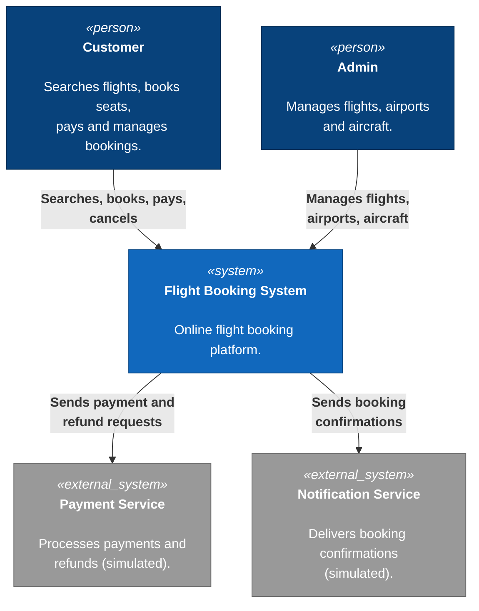
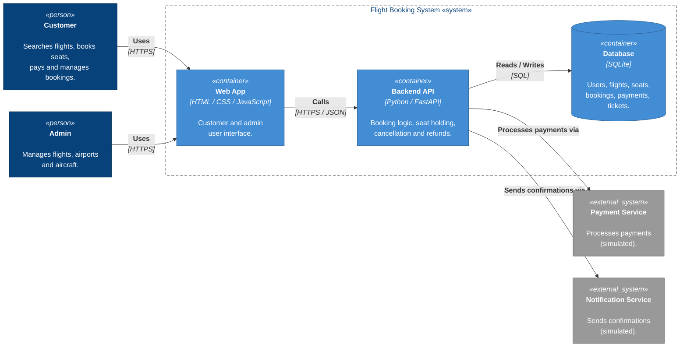

# C4 Diagrams - Flight Booking System (Group 17)

Follows the C4 model . Level 1 shows the system as a black box with its
users and external systems. Level 2 shows the containers and their technology choices.

## Level 1: System Context

## Level 2: Containers

