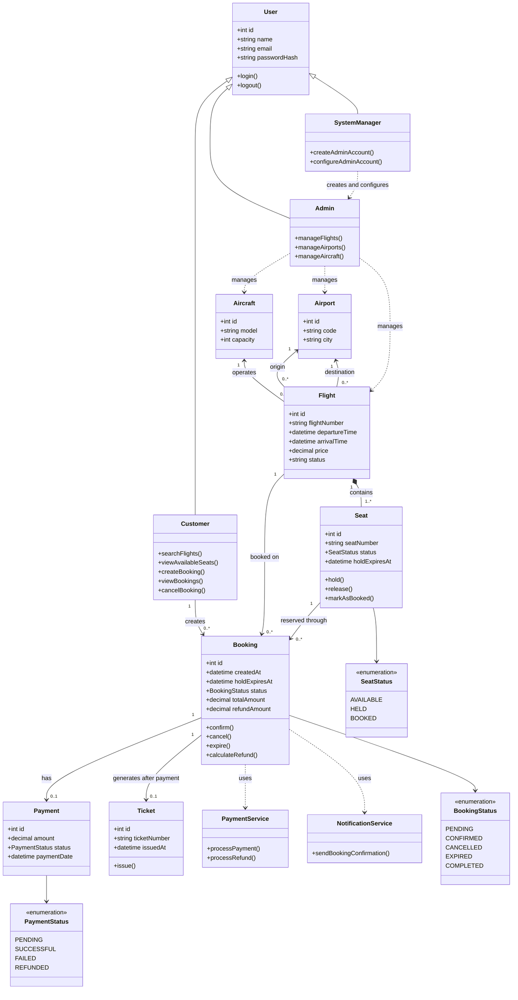

# Class Diagram - Flight Booking System

## 1. Overview

This class diagram represents the main classes, attributes, methods, and relationships of the Flight Booking System.

The system supports customer registration, flight searching, seat selection, booking management, simulated payments, ticket issuance, and administrative operations.

The system also includes a System Manager role responsible for creating and configuring administrator accounts.

## 2. Class Diagram

## 3. Main Class Responsibilities

| Class | Responsibility |
|---|---|
| User | Stores common user information and provides login/logout functionality. |
| Customer | Searches for flights, selects seats, creates bookings, and manages reservations. |
| Admin | Manages flights, airports, and aircraft. |
| SystemManager | Creates and configures administrator accounts. |
| Airport | Stores airport information, including its code and city. |
| Aircraft | Stores aircraft information and passenger capacity. |
| Flight | Stores flight details, schedule, price, and status. |
| Seat | Represents a seat associated with a flight and its availability status. |
| Booking | Manages the booking lifecycle, temporary seat holds, cancellation, and refunds. |
| Payment | Stores simulated payment transaction information and its status. |
| Ticket | Represents the electronic ticket issued after successful payment. |
| PaymentService | Handles simulated payment processing and refunds. |
| NotificationService | Handles simulated booking confirmation notifications. |

## 4. Important Business Rules

1. Customers can register their own accounts. Administrator accounts cannot be created through public registration.
2. The System Manager creates and configures administrator accounts.
3. A seat is temporarily held for 10 minutes after selection.
4. If payment succeeds while the hold is still active, the booking becomes CONFIRMED and the seat becomes BOOKED.
5. If payment fails or the 10-minute hold expires, the booking is cancelled or expired, and the seat is released.
6. An electronic ticket is issued only after successful payment.
7. Customers can cancel confirmed bookings before departure.
8. A 50% refund is provided when cancellation occurs at least 14 days before departure. No refund is provided when cancellation occurs less than 14 days before departure.
9. Payment and notification operations are simulated; no real payment gateway or email service is integrated.
10. The system must prevent two customers from booking the same seat for the same flight.

## 5. Notes

- The `Seat` status represents whether a seat is AVAILABLE, HELD, or BOOKED.
- The `holdExpiresAt` attribute records when a temporary seat hold expires.
- The `BookingStatus` enumeration represents the booking lifecycle.
- The `PaymentStatus` enumeration represents the result of a simulated payment transaction.
- The relationship between Booking and Ticket is optional because a ticket is generated only after successful payment.
- The relationship between Booking and Payment is optional while payment has not yet been initiated.
- The system must validate the seat hold before confirming a booking to prevent expired holds from being used.
