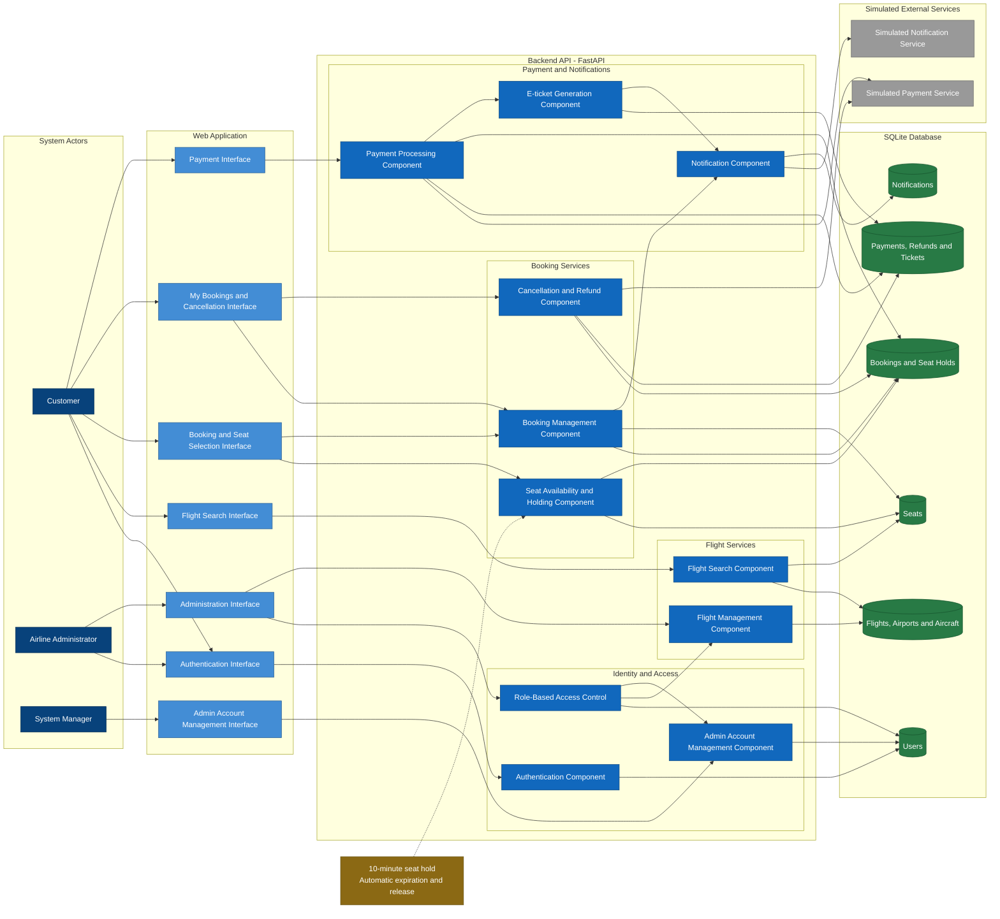

# Component Diagram - Flight Booking System (Group 17)

## 1. Overview

This diagram illustrates the main software components of the Flight Booking System and how they interact.

The system follows a layered architecture consisting of three main layers:

- **Web Application:** Provides interfaces for customers, airline administrators, and the system manager.
- **Backend API:** Handles authentication, flight management, booking operations, seat availability, payments, cancellations, and notifications.
- **Database:** Stores users, flights, airports, aircraft, seats, bookings, payments, tickets, and notifications.

The system also includes simulated external payment and notification services.

## 2. Component Diagram

## 3. Main Components

| Component | Responsibility |
|---|---|
| Authentication | Handles customer registration, login, logout, and administrator authentication. |
| Admin Account Management | Allows the system manager to create and configure administrator accounts in advance. |
| Role-Based Access Control | Restricts administrative functions to authorized administrators. |
| Flight Management | Adds, edits, and deletes flights, airports, and aircraft. |
| Flight Search | Searches and filters available flights. |
| Seat Management | Displays seat availability and manages temporary seat holds. |
| Booking Management | Creates and manages customer bookings. |
| Payment Processing | Processes simulated payments. |
| E-ticket Generation | Generates e-tickets after successful payment. |
| Cancellation and Refund | Cancels bookings and calculates refunds according to the cancellation policy. |
| Notification | Generates simulated booking confirmation notifications. |

## 4. Database Components

| Database Component | Stored Information |
|---|---|
| Users | Customer and administrator account information. |
| Flights, Airports and Aircraft | Flight schedules, airport information, and aircraft information. |
| Seats | Seat numbers, availability, and reservation status. |
| Bookings and Seat Holds | Customer bookings and temporary seat reservations. |
| Payments, Refunds and Tickets | Payment records, refund information, and generated e-tickets. |
| Notifications | Simulated booking confirmation notifications. |

## 5. Important Design Rules

- The Web Application communicates with the Backend API.
- The Backend API handles business logic and database operations.
- The Web Application must not access the database directly.
- Passwords must be stored using secure hashing, not as plain text.
- Administrator accounts are created and configured in advance by the System Manager.
- Public administrator registration is not allowed.
- Only authorized administrators can access administrative management functions.
- Seat holds expire automatically after 10 minutes if payment is not completed.
- The same seat on the same flight cannot be booked by two different customers.
- E-tickets are generated only after successful payment.
- A booking cancelled 14 or more days before departure receives a 50% refund.
- A booking cancelled less than 14 days before departure receives no refund.
- Payment and notification services are simulated and do not use real external services.

## 6. Technology Stack

| Layer | Technology |
|---|---|
| Frontend | HTML, CSS, JavaScript |
| Backend | Python, FastAPI |
| Database | SQLite |
| Testing | pytest |
| Development Workflow | Agentic AI (Claude Code) |
| Version Control | Git and GitHub |

## 7. Related Documentation

- Project description: `docs/project_description.md`
- System requirements: `docs/requirements.md`
- System architecture: `docs/architecture.md`
- C4 Context Diagram: `uml/c4_context.md`
- C4 Container Diagram: `uml/c4_container.md`
- Use Case Diagram: `uml/use_case_diagram.md`
- Class Diagram: `uml/class_diagram.md`
- Sequence Diagram: `uml/sequence_booking.md`
- State Diagram: `uml/state_booking.md`
- Entity Relationship Diagram: `uml/erd.md`
