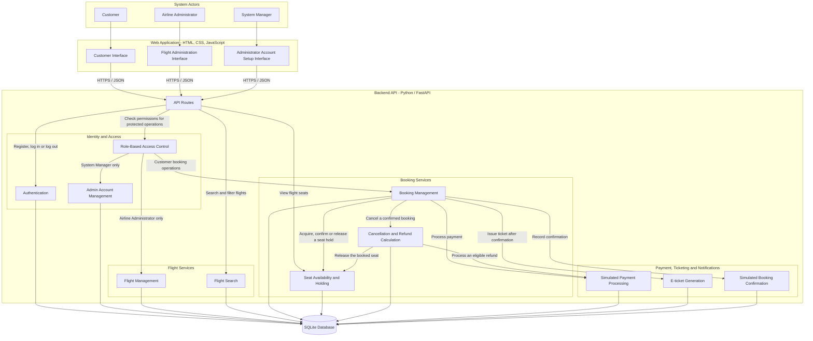

# Component Diagram - Flight Booking System (Group 17)

## 1. Overview

The Flight Booking System has three layers: a web application, a FastAPI backend, and a SQLite database. Customers book flights, airline administrators manage flight data, and the System Manager creates and configures administrator accounts.

The backend simulates payments and records booking confirmations internally. The web application accesses the database through the backend API.

## 2. Component Diagram

## 3. Main Component Responsibilities

| Component | Responsibility |
|---|---|
| API Routes | Receive requests from the web application and route them to the appropriate backend components. |
| Authentication | Registers customers, hashes passwords, validates login credentials, and ends user sessions on logout. |
| Role-Based Access Control | Checks the authenticated user's role before allowing a protected operation. |
| Admin Account Management | Allows the System Manager to create and configure administrator accounts. |
| Flight Management | Allows airline administrators to manage flights, schedules, airports, and aircraft. |
| Flight Search | Finds flights by origin, destination, and date. Supports filtering and sorting results by price and time. |
| Seat Availability and Holding | Displays seat availability, manages 10-minute holds, and releases seats when a hold expires or a booking is cancelled. |
| Booking Management | Creates pending bookings, retrieves the customer's own bookings, and coordinates payment, confirmation, ticket issuance, and cancellation. |
| Simulated Payment Processing | Produces a simulated payment result, records the transaction, and processes eligible simulated refunds. |
| E-ticket Generation | Generates a unique e-ticket for a confirmed booking and stores it in the database. |
| Simulated Booking Confirmation | Records a confirmation message after the booking is confirmed. |
| Cancellation and Refund Calculation | Checks booking ownership and cancellation eligibility, calculates the refund, and coordinates seat release. |

## 4. Data Storage

| Data | Stored information |
|---|---|
| Users | Customer, airline administrator, and System Manager accounts, including roles and password hashes. |
| Airports, aircraft, and flights | Airport codes, aircraft capacity, flight schedules, routes, and prices. |
| Seats | Seat number, associated flight, availability status, and hold expiration time. |
| Bookings | Booking owner, flight, seat, booking status, amount, and applicable refund. |
| Payments and tickets | Simulated payment results and electronic tickets linked to bookings. |
| Booking confirmations | Simulated confirmation records associated with confirmed bookings. |

## 5. Important Design Rules

1. Customers register through the public registration interface. Only the System Manager can create administrator accounts.
2. Only authorized airline administrators can manage flights, airports, and aircraft. Customers can view and cancel only their own bookings.
3. Checking seat availability, acquiring the seat hold, and creating the pending booking happen in one database transaction. Only one active booking can own a seat on a given flight.
4. A seat hold lasts 10 minutes. When the hold expires, the system marks the pending booking as `EXPIRED` and releases its seat.
5. If payment fails while the hold is active, the system marks the pending booking as `CANCELLED` and releases its seat.
6. Before confirming a booking, the backend verifies that payment succeeded and that the booking still owns an active hold. It then marks the booking as `CONFIRMED` and the seat as `BOOKED`.
7. After confirmation, the system issues an e-ticket and records a simulated booking confirmation.
8. A customer can cancel a confirmed booking before departure. Cancellation at least 14 days before departure gives a 50% refund. Cancellation less than 14 days before departure gives no refund.
9. Payment processing, refunds, and booking notifications are simulated inside the backend.

## 6. Technology Stack

| Layer or activity | Technology |
|---|---|
| Frontend | HTML, CSS, JavaScript |
| Backend | Python, FastAPI |
| Database | SQLite |
| Testing | pytest |
| Agentic AI development | Claude Code |
| Version control | Git and GitHub |

## 7. Related Documentation

- [Project Description](../docs/project_description.md)
- [Requirements](../docs/requirements.md)
- [Architecture](../docs/architecture.md)
- [C4 System Context Diagram](c4_context.md)
- [C4 Container Diagram](c4_container.md)
- [Use Case Diagram](use_case_diagram.md)
- [Booking Sequence Diagram](sequence_booking.md)
- [Booking State Diagram](state_booking.md)
- [Booking Activity Diagram](activity_booking.md)
- [Class Diagram](class_diagram.md)
- [Entity Relationship Diagram](erd.md)
- [Deployment Diagram](deployment_diagram.md)