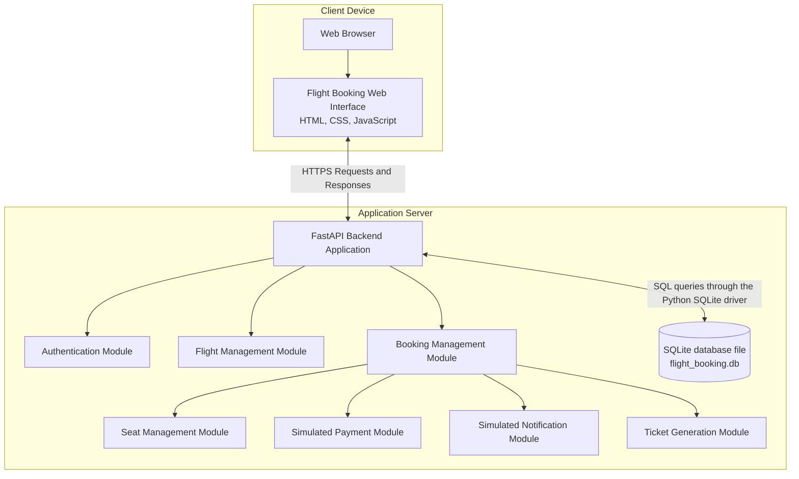

# Deployment Diagram - Flight Booking System

## 1. Overview

This document describes the physical deployment architecture of the Flight Booking System, including the hardware nodes, software components, and communication between them.

The system uses a web-based three-tier architecture consisting of a client layer, an application layer, and a database layer.

## 2. Deployment Diagram

## 3. Deployment Nodes

| Node | Description |
|---|---|
| Client Device | The user's computer or mobile device used to access the system. |
| Web Browser | Runs the web application interface. |
| Web Interface | Built using HTML, CSS, and JavaScript. |
| Application Server | Hosts and runs the Python FastAPI backend. |
| FastAPI Backend | Handles requests, business logic, authentication, and communication with the database. |
| SQLite database file | A single database file stored on the application server and accessed by the backend. Stores users, airports, aircraft, flights, seats, bookings, payments, tickets, and notifications. |

## 4. Software Components

- **Authentication Module:** Handles customer login and authentication.
- **Flight Management Module:** Handles flight searches and flight information.
- **Booking Management Module:** Creates, confirms, cancels, and expires bookings.
- **Seat Management Module:** Checks seat availability and manages temporary seat holds.
- **Simulated Payment Module:** Processes simulated payment transactions without using a real payment gateway.
- **Simulated Notification Module:** Handles simulated booking confirmation notifications.
- **Ticket Generation Module:** Generates electronic tickets after successful payment and booking confirmation.

## 5. Communication Between Nodes

1. The customer accesses the system through a web browser.
2. The web interface sends requests to the FastAPI backend through HTTPS.
3. The backend processes requests and applies the required business rules.
4. The backend communicates with the SQLite database to retrieve or update information.
5. The simulated payment module processes payment requests internally.
6. The notification module handles simulated booking confirmation.
7. The backend returns the appropriate response to the web interface.

## 6. Deployment Considerations

- The system follows a three-tier architecture.
- The frontend communicates with the backend through HTTPS in the deployment environment.
- HTTP may be used during local development.
- The frontend does not access the database directly.
- The backend is responsible for all business logic and database access.
- SQLite stores the system's persistent data in a single file on the application server. SQLite is an embedded database, so it does not run on a separate database server.
- Passwords must be stored as secure hashes.
- Seat reservations expire automatically after 10 minutes if payment is not completed.
- Payment and notification services are simulated internal modules.
- No real external payment gateway or email service is required.

## 7. Related Documents

- `architecture.md`
- `project_description.md`
- `requirements.md`
- `component_diagram.md`
- `sequence_booking.md`
- `class_diagram.md`
- `erd.md`
