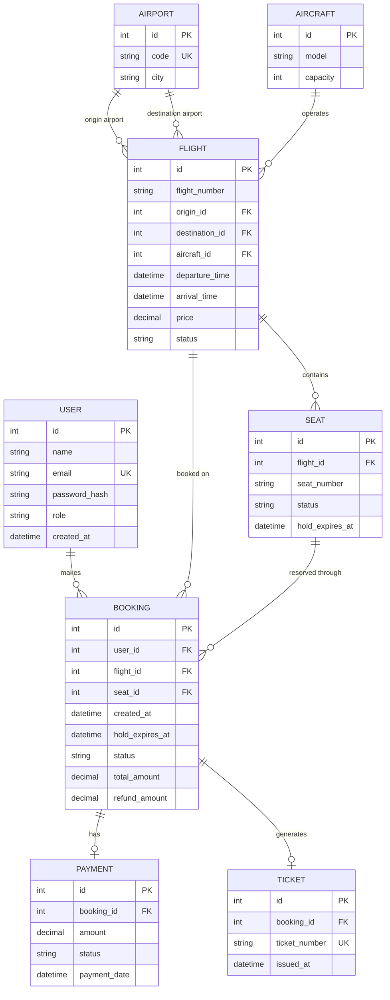

# ERD - Data Model

## 1. Overview

This Entity Relationship Diagram (ERD) represents the database structure of the Flight Booking System.

It defines the main entities, their attributes, primary keys, foreign keys, and relationships.

The database supports customer accounts, administrator accounts, airports, aircraft, flights, seats, bookings, simulated payments, and electronic tickets.

## 2. Entity Relationship Diagram

## 3. Entity Descriptions

| Entity | Description |
|---|---|
| USER | Stores customer, administrator, and system manager account information. |
| AIRPORT | Stores airport details, including airport code and city. |
| AIRCRAFT | Stores aircraft information and passenger capacity. |
| FLIGHT | Stores flight schedules, prices, airport references, and aircraft information. |
| SEAT | Stores seats belonging to a specific flight and their availability status. |
| BOOKING | Stores customer reservations, booking status, temporary seat holds, and refund information. |
| PAYMENT | Stores simulated payment transaction information and payment status. |
| TICKET | Stores electronic ticket information issued after successful payment. |

## 4. Important Database Rules and Constraints

### USER
- Each user has a unique email address.
- The `role` attribute identifies the account type: CUSTOMER, ADMIN, or SYSTEM_MANAGER.
- Customers can register through the system.
- Administrator accounts are created and configured by the System Manager.

### FLIGHT
- Each flight has one origin airport and one destination airport.
- Each flight operates using one aircraft.
- The origin and destination airports must be different.
- Flight departure time must be earlier than arrival time.

### SEAT
- Each seat belongs to one flight.
- The combination of `flight_id` and `seat_number` must be unique.
- Seat status can be AVAILABLE, HELD, or BOOKED.
- A temporary seat hold expires after 10 minutes if payment is not completed.

### BOOKING
- Each booking belongs to one customer.
- Each booking is associated with one flight and one seat.
- Booking status can be PENDING, CONFIRMED, CANCELLED, EXPIRED, or COMPLETED.
- A booking must not be confirmed if its temporary seat hold has expired.
- The system must prevent multiple active bookings for the same seat on the same flight.

### PAYMENT
- Each payment belongs to one booking.
- Payment status can be PENDING, SUCCESSFUL, FAILED, or REFUNDED.
- Payment processing and refunds are simulated.
- A booking can be confirmed only after successful payment.

### TICKET
- Each ticket belongs to one booking.
- A ticket is generated only after successful payment.
- Each ticket has a unique ticket number.

## 5. Cancellation and Refund Policy

- Customers can cancel confirmed bookings before flight departure.
- If cancellation occurs 14 days or more before departure, the customer receives a 50% refund.
- If cancellation occurs less than 14 days before departure, no refund is provided.
- The refund amount is stored in the `refund_amount` attribute of BOOKING.
- The payment status is updated according to the refund result.

## 6. Relationship and Cardinality Explanation

| Relationship | Cardinality | Explanation |
|---|---|---|
| USER - BOOKING | One-to-Many | One user can create multiple bookings. |
| AIRPORT - FLIGHT (Origin) | One-to-Many | One airport can be the origin of multiple flights. |
| AIRPORT - FLIGHT (Destination) | One-to-Many | One airport can be the destination of multiple flights. |
| AIRCRAFT - FLIGHT | One-to-Many | One aircraft can operate multiple flights over time. |
| FLIGHT - SEAT | One-to-Many | One flight contains multiple seats. |
| FLIGHT - BOOKING | One-to-Many | One flight can have multiple bookings. |
| SEAT - BOOKING | One-to-Many | A seat can have multiple historical bookings over time, but only one active booking at a time. |
| BOOKING - PAYMENT | One-to-Zero-or-One | A booking may have no payment initially or one payment record. |
| BOOKING - TICKET | One-to-Zero-or-One | A booking may have no ticket until payment succeeds. |

## 7. Additional Implementation Notes

- Foreign keys must enforce referential integrity between related entities.
- The system should use database transactions when holding or confirming seats to prevent double booking.
- The 10-minute expiration rule must be checked before confirming a booking.
- A database-level constraint or transactional validation must prevent multiple active bookings for the same flight seat.
- Passwords must be stored as secure hashes, never as plain text.
- Payment and notification functionality are simulated and do not require real external payment or email services.
