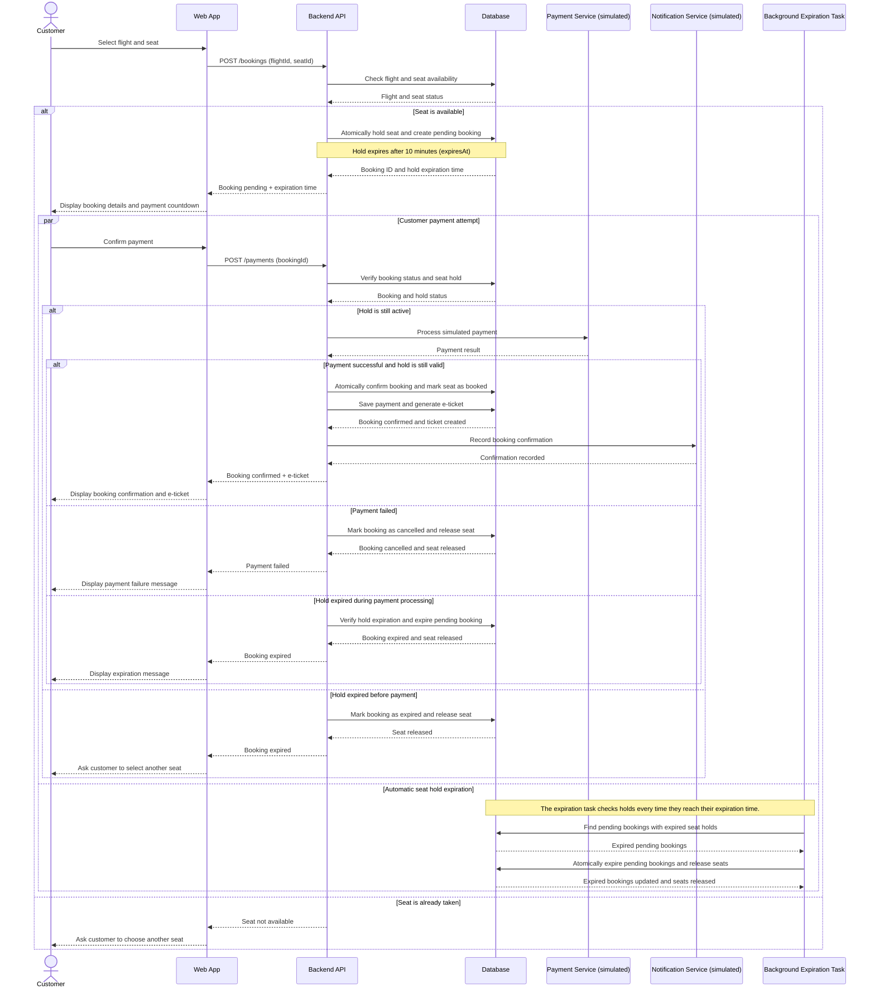

# Sequence Diagram - Book a Flight (UC-01)

## 1. Overview

This sequence diagram illustrates the process of booking a flight, selecting a seat, holding the seat temporarily, completing simulated payment, and generating an e-ticket.

It describes the interactions between the Customer, Web Application, Backend API, Database, Simulated Payment Service, and Simulated Notification Service.

The system uses a 10-minute temporary seat hold to prevent multiple customers from booking the same seat simultaneously.

## 2. Sequence Diagram

## 3. Main Process Description

| Step | Description |
|---|---|
| 1. Select Flight | The customer selects a flight and an available seat. |
| 2. Check Availability | The backend checks whether the selected seat is available. |
| 3. Create Booking | The backend creates a pending booking and temporarily holds the seat. |
| 4. Start Seat Hold | The system holds the seat for 10 minutes and records its expiration time. |
| 5. Payment | The customer confirms payment through the simulated payment service. |
| 6. Payment Verification | The backend verifies the payment result and checks that the seat hold is still valid. |
| 7. Confirm Booking | If payment succeeds within the hold period, the backend confirms the booking and marks the seat as booked. |
| 8. Generate E-ticket | The system generates an e-ticket after successful payment and booking confirmation. |
| 9. Notification | The system records a simulated booking confirmation notification. |
| 10. Release Seat | If payment fails or the hold expires, the system releases the seat. |

## 4. Alternative Scenarios

### 4.1 Seat Already Taken

- The backend detects that the selected seat is unavailable.
- The booking is not created.
- The customer is asked to select another seat.

### 4.2 Payment Failure

- The simulated payment service returns a failure result.
- The booking is marked as cancelled.
- The temporary seat hold is released.
- The customer receives a payment failure message.

### 4.3 Seat Hold Expiration

- The customer has 10 minutes to complete payment.
- A background expiration task checks expired pending bookings.
- If payment has not been completed, the booking is marked as expired.
- The seat is released and becomes available to other customers.

### 4.4 Payment Processing During Expiration

- The backend checks the seat hold again before confirming the booking.
- If the hold has expired, the booking cannot be confirmed.
- No e-ticket is generated for an expired booking.

## 5. Important Business Rules

- A seat can only be held if it is available.
- A selected seat is held for 10 minutes.
- The expiration time is recorded when the booking is created.
- Only one customer can hold or book a specific seat on a specific flight at a time.
- Seat availability checks and seat holding must be performed atomically to prevent double booking.
- Payment processing is simulated.
- A booking is confirmed only after successful payment and verification of the active seat hold.
- An e-ticket is generated only after successful payment and booking confirmation.
- Failed payments result in booking cancellation and seat release.
- Expired seat holds are automatically released.
- Booking confirmation notifications are simulated and recorded by the system.

## 6. Related Documentation

- Project Description: `docs/project_description.md`
- Requirements: `docs/requirements.md`
- Architecture: `docs/architecture.md`
- Component Diagram: `uml/component_diagram.md`
- Use Case Diagram: `uml/use_case_diagram.md`
- State Diagram: `uml/state_booking.md`
- Class Diagram: `uml/class_diagram.md`
- Entity Relationship Diagram: `uml/erd.md`
