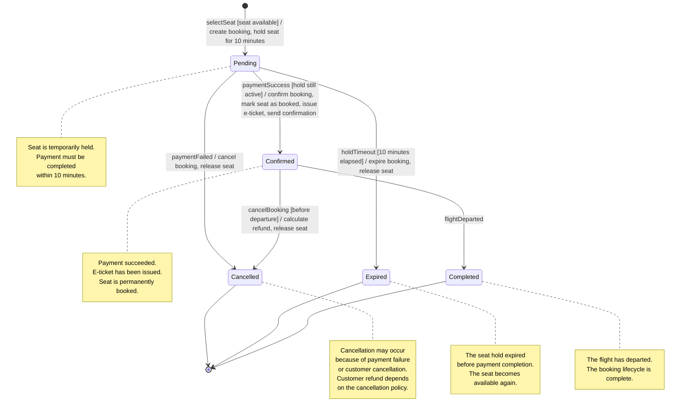

# State Diagram - Booking (Group 17)

## 1. Overview

This state diagram describes the lifecycle of a Booking object in the Flight Booking System.

A booking moves through different states depending on seat availability, payment results, seat hold expiration, customer cancellation, and flight departure.

The system uses a 10-minute temporary seat hold to prevent multiple customers from booking the same seat simultaneously.

## 2. State Diagram

## 3. Booking States

| State | Meaning |
|---|---|
| Pending | A seat is temporarily held for 10 minutes while waiting for payment. |
| Confirmed | Payment succeeded, the booking is confirmed, and an e-ticket is issued. |
| Cancelled | The booking was cancelled because payment failed or the customer requested cancellation. |
| Expired | The 10-minute seat hold expired before payment was completed. |
| Completed | The flight has departed and the booking lifecycle is complete. |

## 4. State Transition Descriptions

| Current State | Event / Condition | Next State | Action |
|---|---|---|---|
| Initial | Customer selects an available seat | Pending | Create booking and hold seat for 10 minutes. |
| Pending | Payment succeeds and seat hold is still active | Confirmed | Confirm booking, mark seat as booked, generate e-ticket, and send confirmation. |
| Pending | Payment fails | Cancelled | Cancel booking and release seat. |
| Pending | 10-minute hold expires | Expired | Expire booking and release seat. |
| Confirmed | Customer cancels before departure | Cancelled | Calculate refund according to the cancellation policy and release seat. |
| Confirmed | Flight departs | Completed | Mark booking as completed. |

## 5. Business Rules

- A booking starts in the Pending state when a customer selects an available seat.
- A selected
