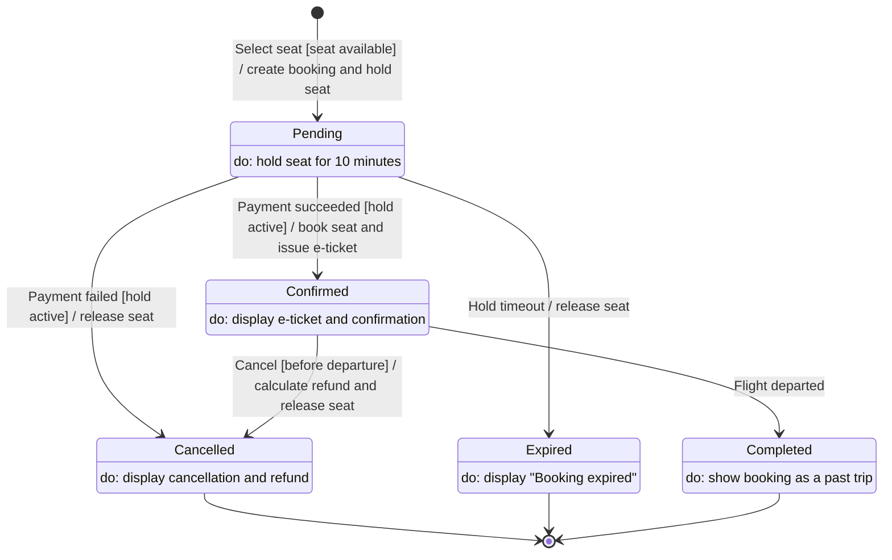

# State Diagram - Booking (Group 17)

## 1. Overview

This state diagram shows how a booking changes its state in response to events during its lifetime, from the moment a customer selects a seat until the booking ends. It follows the state diagram notation in slide SD06: an initial state, states with their `do:` activity, transitions labelled `event [guard] / action`, and a final state. The seat status that goes with each booking state is listed in the States Description table.

## 2. State Diagram

## 3. States Description

| State | Description |
|---|---|
| Pending | The customer has selected a seat and a booking exists. The seat is `HELD` for this booking for 10 minutes, so no other customer can select it. The system waits for the simulated payment. |
| Confirmed | The payment succeeded while the hold was active. The seat is `BOOKED`. The customer can view the e-ticket and the simulated booking confirmation. |
| Cancelled | The payment failed while the hold was active, or the customer cancelled the confirmed booking before departure. The seat is `AVAILABLE` again. A refund is recorded when the cancellation is eligible. |
| Expired | The 10-minute hold ended before payment succeeded. The seat is `AVAILABLE` again. A late payment cannot confirm this booking. |
| Completed | The flight departed while the booking was confirmed. The seat stays `BOOKED` and the booking is kept as a past trip. |

## 4. Stimulus Description

| Stimulus | Description |
|---|---|
| Select seat | A logged-in customer selects a seat on a flight and requests a booking (FR-07). |
| Payment succeeded | The simulated payment for a pending booking returns success (FR-09). |
| Payment failed | The simulated payment for a pending booking returns failure (FR-09). |
| Hold timeout | 10 minutes have passed since the seat was held and the booking is still pending (FR-08). |
| Cancel | The customer cancels their own confirmed booking (FR-12). |
| Flight departed | The departure time of the flight has passed. |

## 5. Guard Conditions

| Guard | Meaning |
|---|---|
| [seat available] | The seat is not held or booked by another booking. The check, the new booking and the seat hold happen in one database transaction, so only one of two simultaneous requests for the same seat succeeds (FR-08). |
| [hold active] | The booking is still pending and its 10-minute hold has not expired. |
| [before departure] | The flight has not departed yet. |

## 6. Related Documents

- [Requirements](../docs/requirements.md)
- [Class Diagram](class_diagram.md) (`Booking`, `BookingStatus`, `Seat`, `SeatStatus`)
- [Booking Sequence Diagram](sequence_booking.md)
- [Booking Activity Diagram](activity_booking.md)
- [Use Case Descriptions](use_case_description.md)
