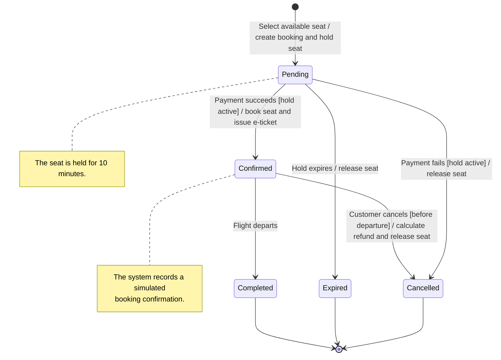

# State Diagram - Booking (Group 17)

## 1. Overview

This state diagram describes the lifecycle of a booking in the Flight Booking System. A booking starts in the Pending state when the customer reserves an available seat. Its next state depends on the payment result, the 10-minute seat hold, customer cancellation, or flight departure.

## 2. State Diagram

## 3. Booking States

| State | Meaning |
|---|---|
| Pending | The customer has a booking and the seat is temporarily held while awaiting payment. |
| Confirmed | Payment succeeded while the hold was active. The seat is booked and an e-ticket is issued. |
| Cancelled | Payment failed during an active hold, or the customer cancelled a confirmed booking before departure. |
| Expired | The 10-minute hold ended before the booking was confirmed. The seat is available again. |
| Completed | The flight departed with the booking confirmed. The booking lifecycle is complete. |

## 4. State Transitions

| Current state | Event or condition | Next state | System action |
|---|---|---|---|
| Initial | The customer reserves an available seat. | Pending | Create the booking, hold the seat, and record the hold expiration time in one transaction. |
| Pending | Payment succeeds and the booking still owns an active hold. | Confirmed | Confirm the booking, mark the seat as booked, issue an e-ticket, and record a simulated confirmation. |
| Pending | Payment fails while the hold is active. | Cancelled | Cancel the pending booking, release its seat, and display the payment failure message. |
| Pending | The 10-minute hold expires. | Expired | Expire the pending booking and release its seat. |
| Confirmed | The customer cancels their booking before departure. | Cancelled | Calculate the applicable refund, cancel the booking, and release the seat. |
| Confirmed | The flight departs. | Completed | Mark the booking as completed. |

## 5. Business Rules

1. A booking starts in the Pending state when a customer reserves an available seat.
2. A selected seat is held for 10 minutes. If the hold expires before the booking is confirmed, the booking moves from Pending to Expired and the seat becomes available again.
3. Before confirming payment, the backend checks that the booking is still Pending and still owns an active hold on the seat. An expired booking cannot be confirmed.
4. If payment fails while the hold is active, the booking moves from Pending to Cancelled and the system releases the seat.
5. When the booking becomes Confirmed, the system marks the seat as booked, issues an e-ticket, and records a simulated booking confirmation.
6. A customer can cancel their own confirmed booking before departure. Cancellation at least 14 days before departure gives a 50% refund. Cancellation less than 14 days before departure gives no refund.
7. When the flight departs, a confirmed booking moves to Completed.
8. Cancelled, Expired, and Completed are final booking states.

## 6. Related Documents

- [Requirements](../docs/requirements.md)
- [Booking Activity Diagram](activity_booking.md)
- [Booking Sequence Diagram](sequence_booking.md)
- [Use Case Descriptions](use_case_description.md)
- [Entity Relationship Diagram](erd.md)