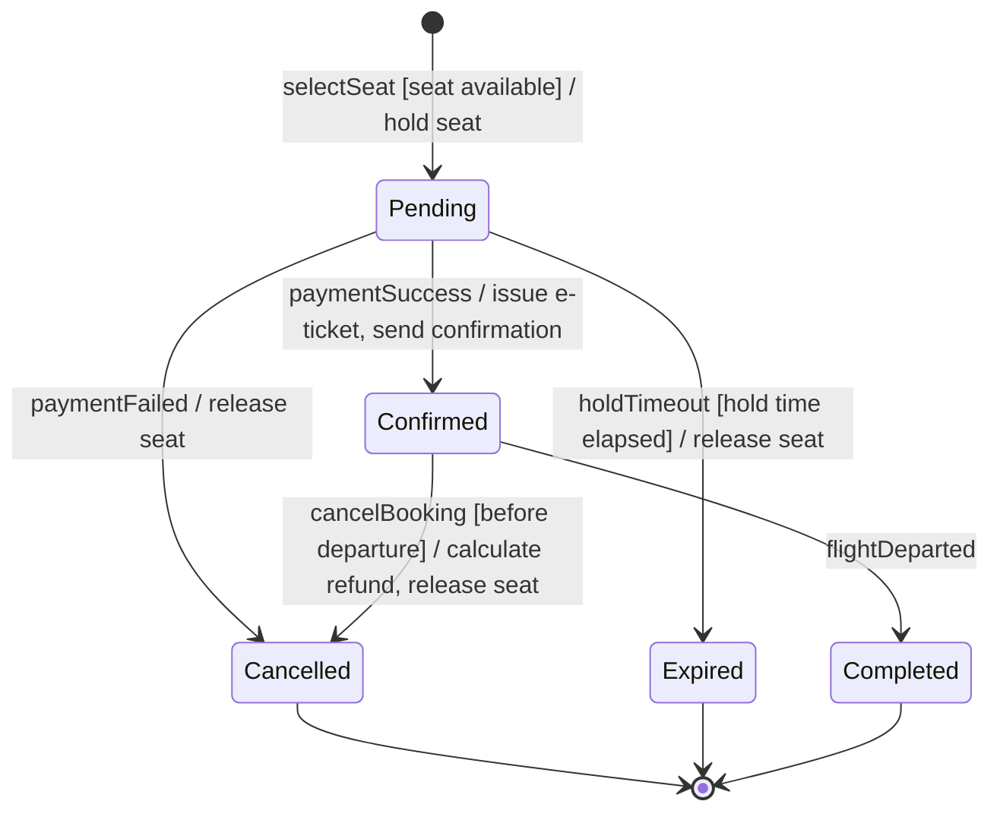

# State Diagram - Booking

Object: **Booking**

## States
| State | Meaning |
|-------|---------|
| Pending | Seat is held, waiting for payment |
| Confirmed | Payment succeeded, e-ticket issued |
| Cancelled | Booking cancelled (payment failed or customer cancelled) |
| Expired | Hold time ran out before payment |
| Completed | Flight has departed |