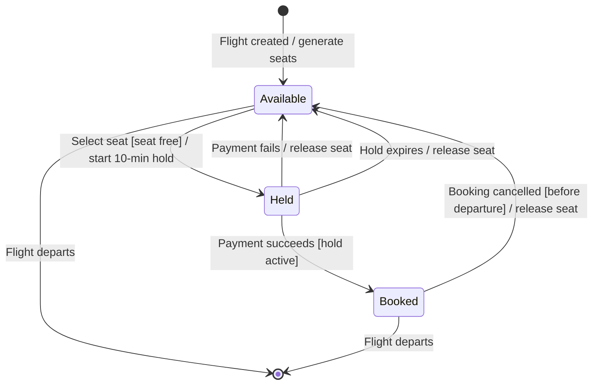

# State Diagram - Seat (Group 17)

## 1. Overview

This state diagram describes the lifecycle of one seat on one flight. It shows how the system prevents two customers from booking the same seat (FR-08): a seat can be held or booked by only one booking at a time, and a held seat returns to Available when the hold expires or payment fails.

## 2. State Diagram

## 3. Seat States

| State | Meaning |
|---|---|
| Available | The seat can be selected by any logged-in customer. |
| Held | The seat is reserved for one pending booking for up to 10 minutes while the customer pays. No other customer can select it. |
| Booked | Payment succeeded while the hold was active. The seat belongs to a confirmed booking. |

## 4. State Transitions

| Current state | Event [guard] | Next state | System action | Requirement |
|---|---|---|---|---|
| Initial | The administrator creates a flight. | Available | Generate the flight's seats. | FR-15 |
| Available | A customer selects the seat [the seat is not held or booked by another booking]. | Held | Create a pending booking, hold the seat and record the hold expiry time in one transaction. | FR-07, FR-08 |
| Held | Payment succeeds [hold still active]. | Booked | Confirm the booking and mark the seat as booked. | FR-09 |
| Held | Payment fails [hold still active]. | Available | Cancel the pending booking and release the seat. | FR-09 |
| Held | The 10-minute hold expires. | Available | Expire the pending booking and release the seat. | FR-08 |
| Booked | The customer cancels the booking [before departure]. | Available | Cancel the booking, calculate the refund and release the seat. | FR-12, FR-13 |
| Available or Booked | The flight departs. | Final | The seat can no longer be selected. | — |

## 5. Business Rules

1. Selecting a seat and holding it happen in one database transaction, so two customers cannot hold the same seat at the same time.
2. A seat is held for 10 minutes. After that, the hold expires and the seat becomes Available again.
3. A held seat can become Booked only if payment succeeds while the hold is still active.
4. When a confirmed booking is cancelled before departure, its seat becomes Available again.

## 6. Related Documents

- [Requirements](../docs/requirements.md)
- [Booking State Diagram](state_booking.md)
- [Class Diagram](class_diagram.md) (`Seat` and `SeatStatus`)
- [Booking Sequence Diagram](sequence_booking.md)
