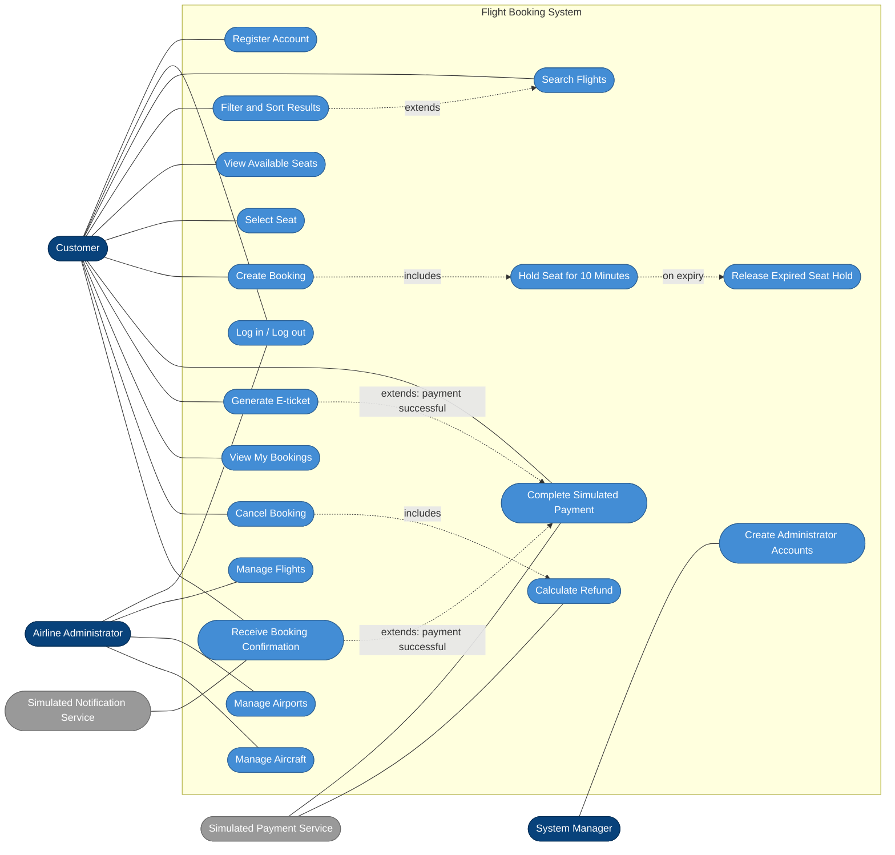

# Use Case Diagram - Flight Booking System (Group 17)

## 1. Overview

This diagram illustrates the interactions between the Flight Booking System and its main actors.

The system has three main actors:

- **Customer:** Registers, searches for flights, selects seats, makes bookings, completes simulated payments, and manages reservations.
- **Airline Administrator:** Manages flight, airport, and aircraft information.
- **System Manager:** Creates and configures administrator accounts in advance.

The system also interacts with simulated payment and notification services.

## 2. Use Case Diagram

## 3. Actor Descriptions

| Actor | Description |
|---|---|
| Customer | Registers, logs in, searches flights, selects seats, creates bookings, pays, receives tickets, and manages bookings. |
| Airline Administrator | Logs in and manages flights, airports, and aircraft. |
| System Manager | Creates and configures administrator accounts in advance. |
| Simulated Payment Service | Processes simulated payment and refund requests. |
| Simulated Notification Service | Records simulated booking confirmation notifications. |

## 4. Main Use Cases

| Use Case | Description |
|---|---|
| Register Account | Allows customers to create new accounts. |
| Log in / Log out | Allows customers and administrators to access and leave their accounts. |
| Search Flights | Searches for flights by origin, destination, and date. |
| Filter and Sort Results | Filters and sorts flights by price and time. |
| View Available Seats | Displays available seats for a selected flight. |
| Select Seat | Allows customers to select an available seat. |
| Create Booking | Creates a booking for the selected flight and seat. |
| Hold Seat for 10 Minutes | Temporarily reserves a selected seat until payment is completed or the hold expires. |
| Release Expired Seat Hold | Automatically releases a seat when its reservation hold expires. |
| Complete Simulated Payment | Processes a simulated payment for a booking. |
| Generate E-ticket | Generates an e-ticket after successful payment. |
| View My Bookings | Displays the customer's existing bookings. |
| Cancel Booking | Allows customers to cancel their bookings according to the cancellation policy. |
| Calculate Refund | Calculates a 50% refund for cancellations made 14 or more days before departure, and no refund otherwise. |
| Receive Booking Confirmation | Generates a simulated booking confirmation notification after successful payment. |
| Manage Flights | Allows administrators to add, edit, and delete flights. |
| Manage Airports | Allows administrators to manage airport information. |
| Manage Aircraft | Allows administrators to manage aircraft information. |
| Create Administrator Accounts | Allows the system manager to create and configure administrator accounts in advance. |

## 5. Business Rules

- Only customers can register through the public registration interface.
- Administrator accounts are created in advance by the System Manager.
- Public administrator registration is not allowed.
- Only authorized administrators can access administrative management functions.
- Customers can search flights by origin, destination, and date.
- A selected seat is held for 10 minutes.
- If payment is not completed within 10 minutes, the seat hold expires and the seat becomes available again.
- The same seat on the same flight cannot be booked by two different customers simultaneously.
- An e-ticket is generated only after successful payment.
- Booking confirmation notifications are generated after successful payment.
- Cancellations made 14 or more days before departure receive a 50% refund.
- Cancellations made less than 14 days before departure receive no refund.
- Booking confirmations are simulated and are not sent as real emails.
- Payment processing is simulated and does not use a real payment gateway.

## 6. Related Documentation

- Project Description: `docs/project_description.md`
- Requirements: `docs/requirements.md`
- Architecture: `docs/architecture.md`
- C4 Context Diagram: `uml/c4_context.md`
- C4 Container Diagram: `uml/c4_container.md`
- Component Diagram: `uml/component_diagram.md`
- Class Diagram: `uml/class_diagram.md`
- Sequence Diagram: `uml/sequence_booking.md`
- State Diagram: `uml/state_booking.md`
- Entity Relationship Diagram: `uml/erd.md`
