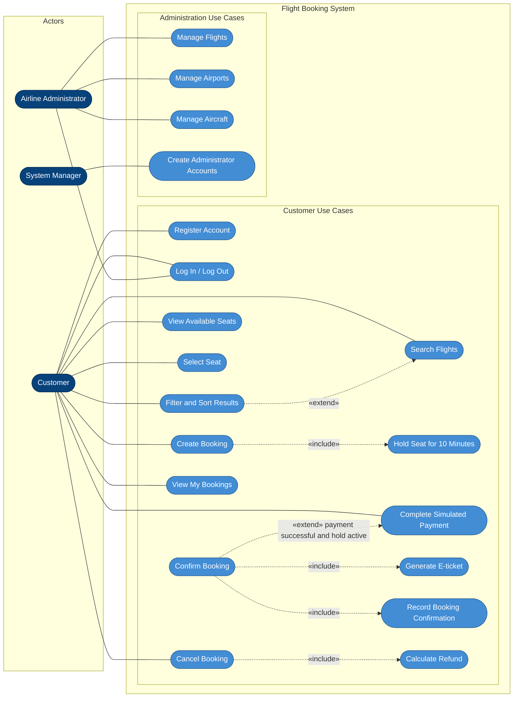

# Use Case Diagram - Flight Booking System (Group 17)

## 1. Overview

This diagram illustrates the interactions between the Flight Booking System and its main actors.

The system has three main actors:

- **Customer:** Registers, logs in, searches for flights, selects seats, creates bookings, completes simulated payments, and manages reservations.
- **Airline Administrator:** Manages flight, airport, and aircraft information.
- **System Manager:** Creates and configures administrator accounts in advance.

Payment processing and booking notifications are simulated internal system functions. They are not external services and do not require integration with third-party systems.

## 2. Use Case Diagram

## 3. Actor Descriptions

| Actor | Description |
|---|---|
| Customer | Registers, logs in, searches for flights, selects seats, creates bookings, completes simulated payments, and manages bookings. |
| Airline Administrator | Logs in and manages flights, airports, and aircraft information. |
| System Manager | Creates and configures administrator accounts in advance. |

## 4. Main Use Cases

| Use Case | Description |
|---|---|
| Register Account | Allows customers to create new accounts. |
| Log In / Log Out | Allows customers and administrators to access and leave their accounts. |
| Create Administrator Accounts | Allows the System Manager to create and configure administrator accounts in advance. |
| Search Flights | Searches for flights by origin, destination, and date. |
| Filter and Sort Results | Allows customers to filter and sort search results by price and time. |
| View Available Seats | Displays the available seats for a selected flight. |
| Select Seat | Allows customers to select an available seat. |
| Create Booking | Creates a pending booking for the selected flight and seat. |
| Hold Seat for 10 Minutes | Temporarily holds the selected seat while payment is pending. |
| Complete Simulated Payment | Processes a simulated payment for a pending booking. |
| Confirm Booking | Confirms the booking when payment succeeds and the seat hold is still active. |
| Generate E-ticket | Generates an e-ticket after successful booking confirmation. |
| Record Booking Confirmation | Records a simulated booking confirmation notification. |
| View My Bookings | Displays the customer's existing bookings. |
| Cancel Booking | Allows customers to cancel their bookings according to the cancellation policy. |
| Calculate Refund | Calculates the applicable refund according to the cancellation policy. |
| Manage Flights | Allows administrators to add, edit, and delete flights. |
| Manage Airports | Allows administrators to manage airport information. |
| Manage Aircraft | Allows administrators to manage aircraft information. |

## 5. Use Case Relationships

### 5.1 Include Relationships

The `<<include>>` relationship represents behavior that is always performed as part of the base use case.

- **Create Booking** includes **Hold Seat for 10 Minutes** because a selected seat must be held when a pending booking is created.
- **Cancel Booking** includes **Calculate Refund** because the system must calculate the applicable refund when a booking is cancelled.
- **Confirm Booking** includes **Generate E-ticket** because a confirmed booking must have an e-ticket.
- **Confirm Booking** includes **Record Booking Confirmation** because the system records a simulated confirmation after successful booking confirmation.

### 5.2 Extend Relationships

The `<<extend>>` relationship represents optional or conditional behavior.

- **Filter and Sort Results** extends **Search Flights** because customers may optionally filter or sort the search results.
- **Confirm Booking** extends **Complete Simulated Payment** because booking confirmation occurs only when payment succeeds and the seat hold is still active.

## 6. Business Rules

- Only customers can register through the public registration interface.
- Administrator accounts are created in advance by the System Manager.
- Public administrator registration is not allowed.
- Only authorized administrators can access administrative management functions.
- Customers can search flights by origin, destination, and date.
- Search results can be filtered and sorted by price and time.
- A selected seat is held for 10 minutes.
- If payment is not completed within 10 minutes, the hold expires and the seat is released.
- A held or booked seat cannot be reserved by another customer for the same flight.
- A booking is confirmed only if payment succeeds while the seat hold is still active.
- An e-ticket is generated only after successful booking confirmation.
- Booking confirmation notifications are recorded after successful booking confirmation.
- Cancellations made 14 or more days before departure receive a 50% refund.
- Cancellations made less than 14 days before departure receive no refund.
- Payment processing is simulated and does not use a real payment gateway.
- Booking notifications are simulated and are not sent as real emails.

## 7. Related Documentation

- Project Description: `docs/project_description.md`
- Requirements: `docs/requirements.md`
- Incremental Development Plan: `docs/incremental_development_plan.md`
- Traceability Matrix: `docs/traceability_matrix.md`
- Architecture: `docs/architecture.md`
- C4 Context Diagram: `uml/c4_context.md`
- C4 Container Diagram: `uml/c4_container.md`
- Component Diagram: `uml/component_diagram.md`
- Class Diagram: `uml/class_diagram.md`
- Use Case Description: `uml/use_case_description.md`
- Sequence Diagram: `uml/sequence_booking.md`
- State Diagram: `uml/state_booking.md`
- Entity Relationship Diagram: `uml/erd.md`
